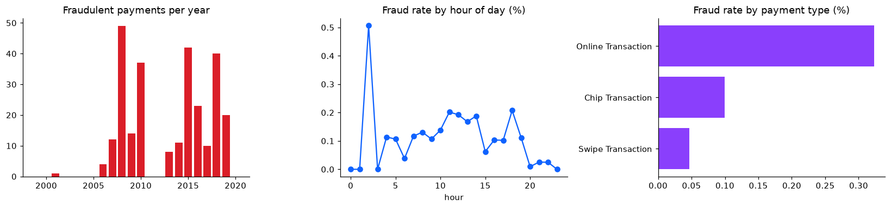
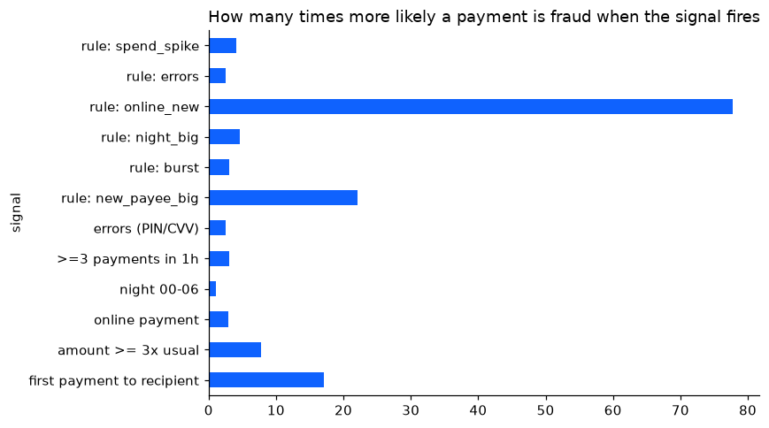
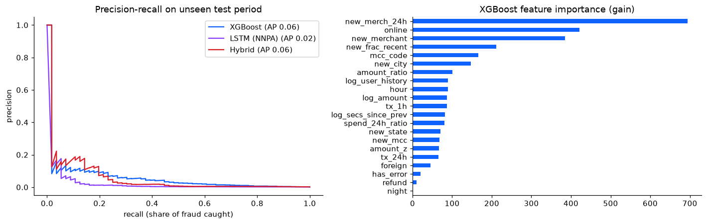
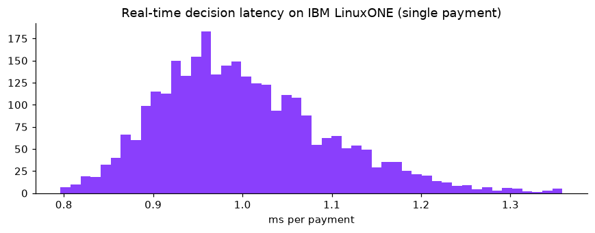
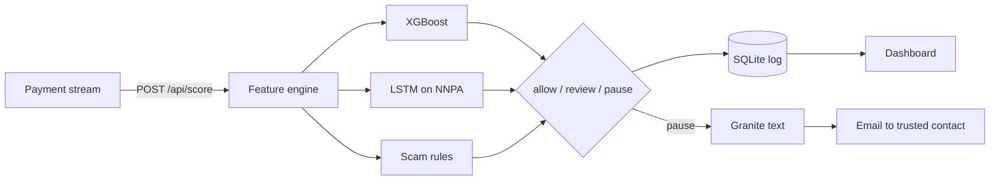

# SafePause

Team PARASITE, IBM Z Datathon 2026, theme: Real-Time AI for Critical Decisions

Scammers get people (very often older people) to send money themselves: "your account is hacked, move the money to a safe account", a relative in trouble, fake investments. The bank sees the real customer, real card and the right PIN, so the payment goes through.

SafePause checks every payment in a few milliseconds on LinuxONE and holds the ones that look like a scam before the money leaves.

How it works:

1. Feature engine keeps a small state per customer and computes 16 behaviour features (first payment to this recipient, amount vs usual, payments in last hour, night, online, PIN errors...)
2. XGBoost on the current payment + LSTM on the last 7 payments (LSTM runs on the Telum II NNPA through ibm-zdnn-plugin) + a few scam rules -> risk score
3. Decision: allow / review (customer confirms) / pause
4. For paused payments IBM Granite (llama.cpp, runs locally) writes a short explanation for the customer and a summary for the analyst
5. Email to the customer's trusted contact
6. Dashboard with the live feed, latency and cases

Nothing leaves the LinuxONE server: the LLM runs locally and customer ids are stored as HMAC-SHA256 pseudonyms.

## Results (IBM LinuxONE z17, Telum II NNPA)

Data: TabFormer extract from the lab image, 245,864 transactions, 19 customers, 271 fraud. Split by time, the test period (2018-01 to 2020-02) is never seen in training.

| | |
|---|---|
| Decision latency, one payment (features + XGBoost + LSTM + rules) | p50 1.1 ms, p99 1.7 ms |
| Batch throughput (2048 payments) | XGBoost ~408k/s, LSTM on NNPA ~251k/s |
| Live service (HTTP, Docker) | ~15 payments/s stream, median 2.4 ms |
| Fraud attacks in test period | 17, stopped 6 (first alert usually on the first payment of the attack) |
| Fraud money blocked after first alert | $1,677 of $3,965 |
| Normal payments paused | ~0.05% |
| Hybrid ROC-AUC | 0.836 (LSTM alone 0.671) |
| Granite explanation | ~10 s per text, async, never blocks the payment |

The data is small (19 customers, 189 fraud cases for training) so the numbers are modest; the same code reads the full 24M-row TabFormer file in chunks.

## Architecture

## Files

- `notebooks/01_data_and_features.ipynb` data, problem analysis, features, time split
- `notebooks/02_hybrid_models_nnpa.ipynb` XGBoost + LSTM, thresholds, test results
- `notebooks/03_genai_granite.ipynb` Granite explanations and email
- `notebooks/04_platform_benchmark.ipynb` latency, throughput, NNPA, security
- `safepause/` package (features, scorer, genai, alerts, store, server, dashboard)
- `scripts/simulate_stream.py` replays test transactions to the API, also used as load test
- `Dockerfile`, `compose.yaml` container built on the LinuxONE AI image

## Running on LinuxONE Community Cloud

1. Server: image `Ubuntu 24.04-datathon`, flavor `AI lab` (event code SSF2026). Docker + Jupyter Lab container as in the [lab guide](https://github.com/linuxone-community-cloud/jupyter-lab-ml), with `-v /home/linux1/shared:/home/ibm-user/shared`.
2. Put the repo into `~/shared/safepause`.
3. Run notebooks 01, 02, 03, 04 in Jupyter.
4. On the host: `cd ~/shared/safepause && bash scripts/run_service.sh`
5. Open `http://<server-ip>:8080` and start the stream:
   `docker exec -it safepause python scripts/simulate_stream.py --reset --rate 15`

Load test: `docker exec -it safepause python scripts/simulate_stream.py --reset --mode all --rate 0 --batch 500`

Real emails: copy `.env.example` to `.env`, put a Gmail address and [app password](https://support.google.com/accounts/answer/185833), then `docker compose up -d`. Without it emails are saved to `artifacts/outbox`.

## API

- `POST /api/score` one payment `{"tx_id","user","ts","amount","merchant","mcc","city","use_chip","errors"}` or a list
- `GET /api/stats`, `/api/feed`, `/api/cases`, `/api/case?tx_id=`
- `GET /api/health`

## Data

[IBM TabFormer](https://github.com/IBM/TabFormer) synthetic card transactions (the extract that comes with the LinuxONE lab image). Split by time into train / validation / test.

## Open source used

- [TensorFlow / Keras](https://www.tensorflow.org/), [ibm-zdnn-plugin](https://pypi.org/project/ibm-zdnn-plugin/)
- [XGBoost](https://github.com/dmlc/xgboost)
- [llama.cpp](https://github.com/ggml-org/llama.cpp), [llama-cpp-python](https://github.com/abetlen/llama-cpp-python), [IBM Granite](https://huggingface.co/ibm-granite)
- [scikit-learn](https://scikit-learn.org/), [pandas](https://pandas.pydata.org/), [NumPy](https://numpy.org/), [Matplotlib](https://matplotlib.org/)
- [Jupyter](https://jupyter.org/), [Chart.js](https://www.chartjs.org/), [IBM Plex](https://github.com/IBM/plex)
- [Docker](https://www.docker.com/), [SQLite](https://sqlite.org/)
- [linuxone-community-cloud/jupyter-lab-ml](https://github.com/linuxone-community-cloud/jupyter-lab-ml) (lab environment)
